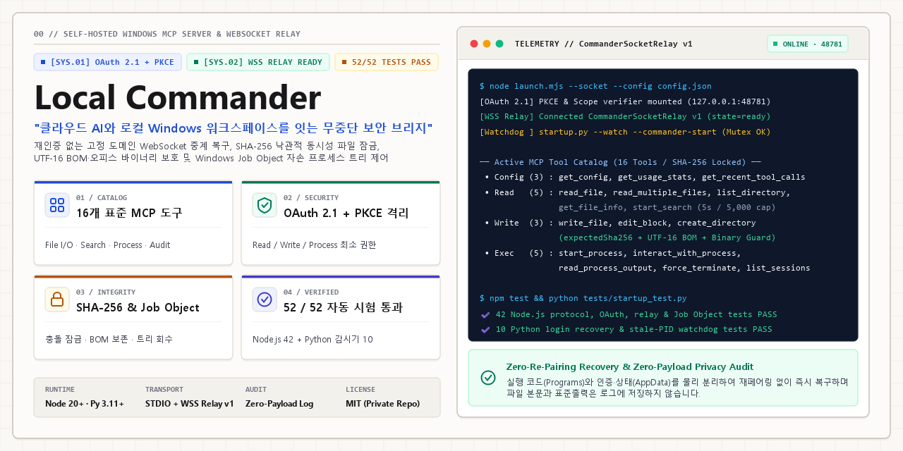
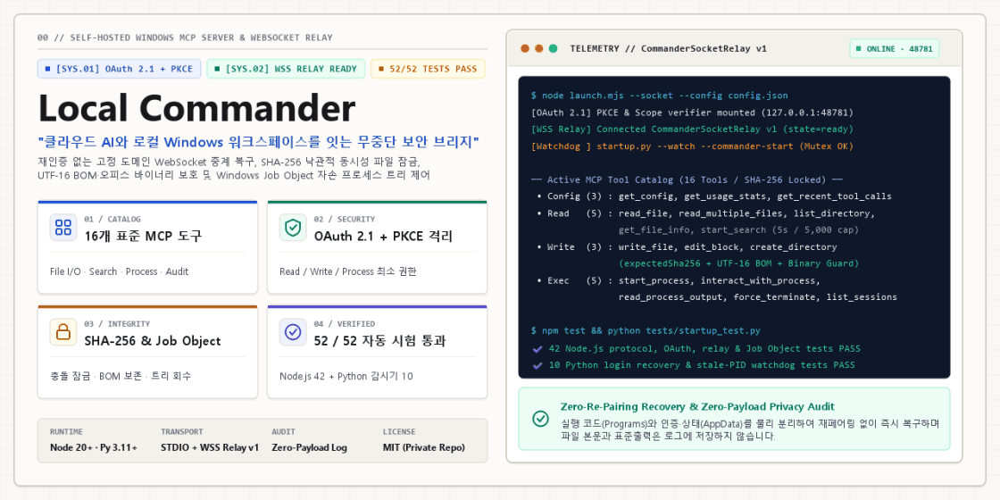
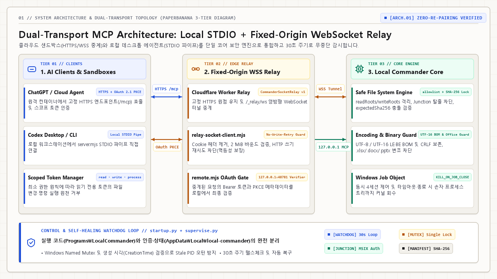
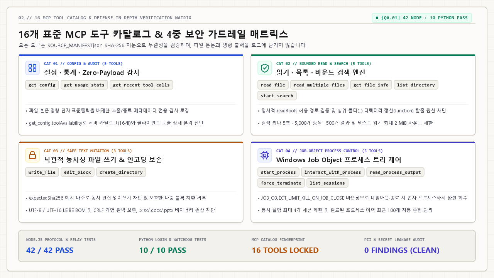

<div align="center">

# Local Commander

**Self-Hosted Windows MCP Server for Local Files, Job-Object Process Execution & Fixed-Address OAuth 2.1 Relay**

[](https://github.com/shinjaehyun20/local-commander)
[](https://nodejs.org/)
[](https://modelcontextprotocol.io/)
[](#security--safety-architecture)
[](#automated-verification-suite)
[](./LICENSE)

<br />



<br />

**Local Commander** is a developer-operated, self-hosted **Model Context Protocol (MCP)** server for Windows 10/11 (`0.x`).  
It connects local desktop clients (Claude Desktop, Cursor, Windsurf, Codex CLI) via **STDIO** and remote web assistants (ChatGPT Web / Developer Mode MCP Connectors) via a **Fixed HTTPS Edge + Outbound WebSocket Relay** protected by **OAuth 2.1 + PKCE (`S256`)** and **One-Time Local Pairing**.

Includes an interactive and CLI **First-Run Setup Wizard (`npm run setup`)** that generates `config.json`, `startup-config.json`, `%LOCALAPPDATA%\local-commander` state directories, and ready-to-paste client snippets for Claude Desktop, Cursor, and Codex CLI.

[Why Local Commander?](#-why-local-commander) • [Quick Start (`npm run setup`)](#-quick-start-with-setup-wizard) • [3-Tier Architecture](#-3-tier-dual-transport-architecture) • [16 MCP Tools](#-16-mcp-tools--security-matrix) • [Verification & Scope](#-automated-verification-suite--scope-boundaries)

</div>

---

## 💡 Why Local Commander?

Running an MCP server that can read/write files and spawn processes on a Windows workstation requires strict operational boundaries—especially when bridging to cloud LLM clients:

| Challenge in Typical Local MCP Servers | How **Local Commander** Solves It |
| :--- | :--- |
| **Silent Overwrites & Stale Edits** | **`expectedSha256` Optimistic Concurrency** — Every `write_file` (on existing files) and `edit_block` verifies the file's current SHA-256 before mutating a single byte, preserving BOM and UTF-8 / UTF-16LE encodings. |
| **Symlink / Reparse-Point Jailbreaks** | **Realpath & Junction Escape Prevention** — Paths are resolved against `fs.realpathSync.native` and checked against approved `readRoots` and `writeRoots`. Symlinks or Windows NTFS junctions pointing outside approved roots are rejected. |
| **Orphaned Background Processes** | **Windows Job Object (`KILL_ON_JOB_CLOSE`)** — Child processes run via `supervise.py` inside a Win32 Job Object (`JOB_OBJECT_LIMIT_KILL_ON_JOB_CLOSE`), ensuring whole-tree cleanup on timeout or parent termination. |
| **Ephemeral Tunnel URLs Break OAuth** | **Fixed HTTPS Origin + Outbound WebSocket Relay** — Your Windows PC opens an outbound `wss://` connection to your fixed Cloudflare Worker (`/_relay/connect`) or Named Tunnel so your OAuth callback and `/mcp` URL remain constant across reboots without opening inbound router ports. |
| **Unauthenticated Remote Endpoints** | **OAuth 2.1 + PKCE (`S256`) + Local Pairing** — Remote `/mcp` access requires OAuth 2.1 Dynamic Client Registration, PKCE `S256`, a locally generated one-time pairing code (`pairing.json`), and explicit scope separation (`desktop.read`, `desktop.write`, `process.execute`). |
| **Corrupt or Truncated Auth State** | **Atomic Persistence & Corrupt-File Isolation** — `writeSecureJson` writes via a sibling temporary file + atomic rename (`fs.renameSync`), while `readJsonIfExists` distinguishes missing files (`ENOENT`) from corrupt JSON—preserving a `.corrupt-<timestamp>` backup and raising `ERR_CORRUPT_STATE_JSON` instead of silently wiping paired state. |

<div align="center">
  
</div>

---

## ⚡ Quick Start with Setup Wizard

### 1. Prerequisites
- **OS**: Windows 10 or Windows 11 (x64)
- **Node.js**: `>= 20.0.0`
- **Python**: `3.11+` (`python.exe` and `pythonw.exe` for Windows Job Object supervision and optional login recovery)

```powershell
git clone https://github.com/shinjaehyun20/local-commander.git
cd local-commander
npm ci --ignore-scripts
```

### 2. Run the Interactive Setup Wizard (`npm run setup`)
The built-in setup wizard validates your `readRoots`, `writeRoots`, and `allowedExecutables`, derives a deterministic 12-character hex `workspaceId`, initializes the state directory (`%LOCALAPPDATA%\local-commander`), and outputs ready-to-paste MCP client snippets:

```powershell
# Interactive mode (prompts for roots, tunnel mode, and remote write policy)
npm run setup

# Or non-interactive CLI mode:
node setup-wizard.mjs --non-interactive `
  --read-roots "C:\Projects,D:\Docs" `
  --write-roots "C:\Projects" `
  --tunnel-mode none
```

This creates:
- `config.json` (your local MCP server configuration, untracked by Git)
- `startup-config.json` (your Windows watchdog configuration, untracked by Git)
- `%LOCALAPPDATA%\local-commander\client-snippets.json` (ready-to-copy snippets for **Claude Desktop**, **Cursor**, and **Codex CLI**)

---

## 🏛️ 3-Tier Dual-Transport Architecture

Local Commander separates **Transport**, **Authentication**, and **Execution** into audited modules with zero external database dependencies:

<div align="center">
  
</div>

### Transport Modes
1. **Mode A — Local STDIO (`server.mjs`)**
   - Zero network listeners. Communicates over standard input/output for local desktop MCP hosts (`Claude Desktop`, `Cursor`, `Windsurf`, `Codex CLI`).
2. **Mode B — Local Read-Only Loopback HTTP (`server.mjs --http`)**
   - Binds strictly to `127.0.0.1` (`port 48780` by default), requires a $\ge 32$-character constant-time compared Bearer token (`tokenFile`), validates `Origin`, and enforces `readOnly: true` (exposing only the 10 read/search/inspect tools).
3. **Mode C — Authenticated Remote OAuth 2.1 + Fixed Edge Relay (`launch.mjs --socket`)**
   - Local Express + `StreamableHTTPServerTransport` binds to `127.0.0.1:48781`.
   - `relay-socket-client.mjs` maintains an authenticated outbound `wss://` connection to your fixed HTTPS relay (`/_relay/connect`) with 15s application heartbeats, bounded 2 MB request / 4 MB response buffers, header/cookie stripping, and automatic reconnect backoff.
   - Transport-level forwarding never auto-retries failed mutating HTTP requests over the relay socket. (End-to-end idempotency across client-initiated retries after a dropped response is governed by `expectedSha256` on file writes/edits.)

---

## 🛠️ 16 MCP Tools & Security Matrix

All 16 tools return structured JSON responses and annotate their MCP capability hints (`readOnlyHint`, `destructiveHint`, `openWorldHint`, `idempotentHint`). When `readOnly` mode is active (`allowRemoteWrites: false` or `--http`), the 6 mutating/process tools are omitted from the server catalog.

<div align="center">
  
</div>

### Read-Only & Diagnostic Tools (`desktop.read` — 10 Tools)
| Tool Name | Purpose | Safety & Bounding |
| :--- | :--- | :--- |
| `get_config` | Inspect allowed `readRoots`, `writeRoots`, `allowedExecutables`, and `toolAvailability` catalog hash (`catalogSha256`). | Read-only; exposes policy metadata without secrets. |
| `get_usage_stats` | Read tool call counters, active process-session count, and service start timestamp. | Read-only telemetry in memory. |
| `get_recent_tool_calls` | Inspect bounded recent audit events (`maxResults`). | Redacts file contents, command arguments, and credentials. |
| `list_directory` | List files and subdirectories inside an approved root with `offset` and `length` paging. | Enforces `readRoots` realpath containment. |
| `read_file` | Read a text file with line-range paging (`offset`, `length`), detected encoding, and `sha256`. | Rejects binary files (`\0` check) and files over `maxReadBytes`. |
| `read_multiple_files` | Batch-read up to 20 approved text files in one call, returning per-file `sha256` or isolated error. | Bounded to 20 files; per-file realpath validation. |
| `get_file_info` | Retrieve size, creation/modification timestamps, line count, and `sha256` for a path. | Enforces `readRoots` realpath containment. |
| `start_search` | Search file names (`files`) or text contents (`content`) under an approved root. | Bounded by `maxSearchResults`; reports truncation cleanly. |
| `read_process_output` | Read buffered `stdout`/`stderr`, running status, and final `exitCode` for an owned `sessionId`. | Does not start or mutate processes. |
| `list_sessions` | List all process sessions owned by this Commander instance and their lifecycle states. | Scoped strictly to Commander-spawned sessions. |

### Mutating File Tools (`desktop.write` — 3 Tools)
| Tool Name | Purpose | Safety & Bounding |
| :--- | :--- | :--- |
| `write_file` | Create, rewrite, or append text files inside `writeRoots`. | Existing files **require** `expectedSha256`; blocks Office/PDF binary extensions (`.xlsx`, `.docx`, `.pptx`, `.hwpx`, `.hwp`, `.pdf`, `.zip`, `.exe`, `.dll`). |
| `edit_block` | Replace exactly one matching `oldText` block with `newText` while preserving encoding & BOM. | Requires `expectedSha256` and **exactly 1** occurrence of `oldText`. |
| `create_directory` | Create a new directory (and parents) inside `writeRoots`. | Does not delete or overwrite existing directories. |

### Process Execution Tools (`process.execute` — 3 Tools)
| Tool Name | Purpose | Safety & Bounding |
| :--- | :--- | :--- |
| `start_process` | Launch an approved executable (`allowedExecutables`) with explicit `args` array and approved `cwd`. | Supervised by `supervise.py` inside a Windows Job Object; enforces `timeoutMs` and `maxProcessOutputBytes`. |
| `interact_with_process` | Write UTF-8 input to `stdin` of a running Commander-owned `sessionId`. | Scoped strictly to active owned sessions. |
| `force_terminate` | Terminate a Commander-owned `sessionId` and its descendant process tree. | Never accepts arbitrary system PIDs. |

---

## 📂 State Directory & File Layout

Local Commander strictly separates **tracked source code** (this repository) from **untracked runtime state** on disk:

- **Default State Directory (`getStateDir()` in `vendor-auth/config/paths.js` and `STATE` in `startup.py`)**:
  - `%LOCALAPPDATA%\local-commander`
  - Override for custom deployments or isolated tests via the environment variable `LOCAL_COMMANDER_STATE`.
- **Files stored inside the State Directory (`%LOCALAPPDATA%\local-commander`)**:
  - `auth/<workspaceId>.json` — OAuth 2.1 registered clients and hashed token records (written atomically via temp file + rename; corrupt JSON is backed up to `.corrupt-<timestamp>` and raises `ERR_CORRUPT_STATE_JSON`).
  - `runtime.json` — Active service PID, port, `workspaceId`, and `connectionState` (`starting` / `ready` / `disconnected`).
  - `pairing.json` — One-time pairing PIN (`code`) and verification URL for connecting a new OAuth client.
  - `client-snippets.json` — Generated by `npm run setup` for quick desktop client configuration.
  - `startup-status.json`, `service.out.log`, `service.err.log` — Watchdog health receipts and supervisor logs.

---

## 🧪 Automated Verification Suite & Scope Boundaries

Run the complete **60-test verification suite** (`49 Node.js tests + 11 Python tests`) locally on Windows:

```powershell
# 1. Run all 49 Node.js unit, integration, OAuth, setup-wizard, WebSocket reconnect & manifest tests
npm test

# 2. Run all 11 Python recovery, PID identity, conflict guard & supervised restart tests
py -3.11 tests/startup_test.py
```

Every push and pull request on `main`/`master` is automatically verified on `windows-latest` via [`.github/workflows/ci.yml`](./.github/workflows/ci.yml).

### What the 60 Automated Tests Verify
| Test File | Count | Verified Behaviors |
| :--- | :---: | :--- |
| `tests/core.test.mjs` | **11** | Allowed root validation, read/write separation, symlink & NTFS junction escape blocking, `expectedSha256` optimistic concurrency, binary extension guard, UTF-16LE preservation, process timeout & descendant tree kill. |
| `tests/server.test.mjs` | **3** | STDIO & loopback HTTP MCP transport, Bearer token guard, read-only mode catalog filtering. |
| `tests/tool-catalog.test.mjs` | **4** | 16-tool schema stability, capability annotations, `get_config.toolAvailability` SHA-256 verification. |
| `tests/remote.test.mjs` | **10** | OAuth 2.1 metadata discovery, Dynamic Client Registration, PKCE `S256` verification, pairing code consumption, scope enforcement (`403 insufficient_scope`), refresh token rotation & reuse detection, **corrupt auth JSON preservation (`ERR_CORRUPT_STATE_JSON` + `.corrupt-*` backup)**, and **atomic JSON write without leftover `.tmp-*` files**. |
| `tests/tunnel.test.mjs` | **5** | Quick, Named, and Relay tunnel config validation and secret redaction. |
| `tests/relay.test.mjs` | **7** | Fixed HTTPS relay upstream registration, path & credential validation. |
| `tests/relay-socket-client.test.mjs` | **5** | WebSocket relay route/header/body validation, cookie stripping, OAuth preservation, **live WebSocket disconnect & automatic reconnect on a new session**, and **reconnect retry exhaustion (`failed` state transition after 4 attempts)**. |
| `tests/setup-wizard.test.mjs` | **3** | End-to-end `runSetupWizard` config generation (`config.json`, `startup-config.json`, `client-snippets.json`), existing config overwrite protection, and validation of missing roots. |
| `tests/manifest.test.mjs` | **1** | Verifies that every file listed in `SOURCE_MANIFEST.json` exists and matches its recorded SHA-256 digest (`35/35 files`). |
| `tests/startup_test.py` | **11** | Missing/reused/unrelated PID detection, Windows path normalization, byte-exact `.stale-*` archiving, port-conflict preservation, live unhealthy owner protection, and **supervised WebSocket service restart via `supervise.py`**. |

### Explicit Scope Boundaries
To keep operational expectations accurate:
- **Verified by Automated Tests**: MCP tool contracts, path/junction containment, `expectedSha256` file locks, Win32 Job Object child cleanup, OAuth 2.1 + PKCE + refresh rotation, corrupt state file preservation & atomic writes, Setup Wizard generation, WebSocket relay disconnect/reconnect & retry exhaustion, and `startup.py` PID inspection + supervised launch dispatch.
- **Host / Environment Level (Not Simulated in CI)**: Actual Windows interactive user logout/login transitions, physical machine reboot cycles, and provisioning an external Cloudflare account/Worker on a separate PC require host-level setup by the developer.

---

## 📄 License

Released under the [MIT License](./LICENSE). See [`THIRD_PARTY_NOTICES.md`](./THIRD_PARTY_NOTICES.md) for upstream attributions.
