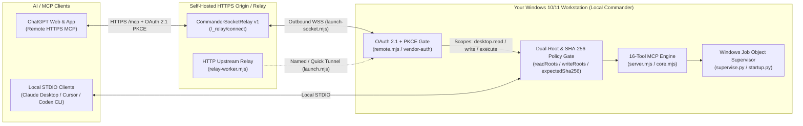

<div align="center">

<p>
  
</p>

<p>
  
</p>

### **Zero Third-Party Relay · 100% Self-Hosted Windows MCP Server for ChatGPT & Local AI Clients**

[](https://github.com/shinjaehyun20/local-commander/actions/workflows/ci.yml)


[](LICENSE)

**[🇺🇸 Why Local Commander](#why-local-commander)** · **[🏗️ Architecture](#system-architecture)** · **[⚡ 3-Minute Quickstart](#3-minute-quickstart)** · **[🛡️ Trust & Sandbox](#start-small-keep-control)** · **[🧰 16-Tool Catalog](#16-tool-reference-catalog)** · **[🇰🇷 한국어 가이드 (Korean v2.0)](#korean-overview)**

</div>

---

<a id="why-local-commander"></a>

## 1. Why Local Commander? (First 5-Second Comparison)

Connect **ChatGPT Web/App** (via your own fixed HTTPS/WSS endpoint) or **local desktop MCP clients** (`stdio`) directly to your Windows 10/11 PC **without routing your source code, files, or shell outputs through a third-party commercial SaaS relay**.

| Evaluation Axis | Commercial Hosted Relay SaaS (`localcmd.app`) | Standard Local `stdio` MCP (`Desktop Commander`, etc.) | **Local Commander (`shinjaehyun20/local-commander`)** |
| :--- | :--- | :--- | :--- |
| **Primary Connection Target** | Cloud relay dashboard | Local `stdio` apps only (Claude Desktop / IDEs) — **cannot connect directly to ChatGPT Web** | **ChatGPT-First (Remote HTTPS/WSS + OAuth 2.1 PKCE) AND Local `stdio` / Loopback HTTP** |
| **Data Sovereignty & Relay Ownership** | Commands & outputs traverse third-party vendor cloud servers | Local process only | **100% Self-Hosted Zero Third-Party Relay** (runs on your Windows PC + your own domain/Worker) |
| **Read vs. Write Boundary Separation** | Single workspace toggle | Global allowed directory list | **Dual Whitelist (`readRoots` vs. `writeRoots`) + Symlink/Junction escape prevention** |
| **Blind-Overwrite Protection** | Direct file overwrite | Direct file overwrite | **Mandatory `expectedSha256` optimistic concurrency check before any existing-file edit** |
| **Windows Path & Process Hygiene** | Host-dependent | Manual termination; raw temp/virtual paths | **Windows Job Object (`supervise.py`) kills full child trees + `fs.realpathSync.native` canonicalization** |
| **Verification & Provenance** | Closed source | Untracked | **60 Automated Tests (49 Node + 11 Python) + `SOURCE_MANIFEST.json` SHA-256 verification** |

---

<a id="system-architecture"></a>

## 2. System Architecture

Local Commander separates **client transport**, **authentication & scope enforcement**, **filesystem/hash policy guards**, and **Windows Job Object process supervision** into auditable layers:



---

<a id="3-minute-quickstart"></a>

## 3. 3-Minute Quickstart & First Prompts

### Step 1 — Clone & Install (Windows 10/11, Node.js 20+, Python 3.11+)

```powershell
git clone https://github.com/shinjaehyun20/local-commander.git
cd local-commander
npm ci --ignore-scripts
```

### Step 2 — Run the Setup Wizard & Generate Client Snippets

```powershell
# Interactive setup wizard (writes config.json and prints client configuration snippets)
npm run setup -- --print-clients

# Or non-interactive read-first setup for a specific project directory:
node setup-wizard.mjs --non-interactive --read-root "D:\workspace" --write-root "D:\workspace\sandbox" --mode local --print-clients
```

### Step 3 — Connect Your AI Client

- **ChatGPT (Active Maintainer Deployment — Fixed HTTPS/WSS Relay)**:
  - Uses outbound WebSocket relay recovery (`node launch.mjs --socket` / `launch-socket.mjs` with `relay-socket-client.mjs`) or HTTP upstream tunnel (`launch.mjs` + `relay-worker.mjs`) backed by `remote.mjs` OAuth 2.1 + PKCE (`lc_client_`, `lc_at_`, `lc_rt_` neutral token prefixes).
- **Claude Desktop / Cursor / Codex CLI (Local `stdio` Snippets)**:
  - Copy the terminal snippet printed by `npm run setup -- --print-clients` into `%APPDATA%\Claude\claude_desktop_config.json`, `~/.cursor/mcp.json`, or `~/.codex/config.toml`.

### Step 4 — 3 Copy-Paste First Prompts to Test Immediately

Once connected, paste these 3 prompts in order to verify read boundaries, surgical SHA-256 diff edits, and supervised process execution:

**Prompt 1 — Verify `readRoots` vs. `writeRoots` Sandbox Boundaries (Read-Only)**
```text
Use Local Commander to call get_config and list_directory on my configured workspace, then show me which folders are read-only (readRoots) versus writable (writeRoots).
```

**Prompt 2 — Streaming Search + SHA-256 Guarded Surgical Diff (`start_search` + `edit_block`)**
```text
Use Local Commander to search for TODO comments in my workspace with start_search, read the matching file with read_file to obtain its current sha256, and update that exact block using edit_block with expectedSha256.
```

**Prompt 3 — Run a Supervised Verification Process (`start_process` + `read_process_output`)**
```text
Use Local Commander to run "npm test" in my project directory with start_process, read the output with read_process_output, and summarize the test results.
```

---

<a id="start-small-keep-control"></a>

## 4. Start Small. Keep Control. (`readRoots` vs. `writeRoots` Trust UX)

Worried about an AI agent modifying files outside your target folder or overwriting unsaved local work? Local Commander enforces **four deterministic safety gates** in [`core.mjs`](core.mjs) and [`remote.mjs`](remote.mjs):

1. **Dual Directory Whitelist (`readRoots` vs. `writeRoots`)**: Give the AI broad context across reference repositories in `readRoots`, while restricting file creation and edits strictly to `writeRoots`.
2. **Canonical Path & Symlink Escape Prevention**: Every path and parent directory is resolved through `fs.realpathSync.native` (normalizing Windows 8.3 short paths like `RUNNER~1` and blocking symlink/junction traversal outside allowed roots).
3. **Optimistic Concurrency (`expectedSha256`)**: `write_file` (on existing files) and `edit_block` require the caller to pass the exact `expectedSha256` returned by `read_file`. If you edited the file locally in your IDE, the hash changes and the stale AI overwrite is rejected.
4. **Explicit Shell & Remote Write Switches**: Both `allowShell` and `allowRemoteWrites` default to `false`.

```json
{
  "name": "Local Commander",
  "readRoots": [
    "D:\\workspace",
    "C:\\Docs\\Architecture-Reference"
  ],
  "writeRoots": [
    "D:\\workspace\\sandbox"
  ],
  "allowShell": false,
  "allowRemoteWrites": false
}
```

---

<a id="16-tool-reference-catalog"></a>

## 5. 16-Tool Reference Catalog

The MCP engine ([`server.mjs`](server.mjs) / [`core.mjs`](core.mjs)) exposes **16 tools across 5 categories**. When running in read-only HTTP mode (`--http`) or remote mode with `"allowRemoteWrites": false`, only the 10 read/diagnostic tools (`desktop.read`) are exposed.

| Category | Tool Name | OAuth Scope | Deterministic Guard & Description |
| :--- | :--- | :--- | :--- |
| **1. Runtime Config & Diagnostics** | `get_config` | `desktop.read` | Returns active `readRoots`, `writeRoots`, `allowShell`, `allowRemoteWrites`, and tool catalog metadata. |
| | `get_usage_stats` | `desktop.read` | Returns session counters and per-tool invocation statistics. |
| | `get_recent_tool_calls` | `desktop.read` | Returns bounded ring-buffer history of recent tool calls for auditability. |
| **2. Filesystem Read & Metadata** | `list_directory` | `desktop.read` | Lists entries inside an allowed `readRoots` directory with type and size metadata. |
| | `read_file` | `desktop.read` | Reads text/UTF-16/UTF-8 files within `readRoots` and returns content + `sha256` + line endings (`CRLF`/`LF`). |
| | `read_multiple_files` | `desktop.read` | Batch-reads multiple files within `readRoots` with per-file `sha256` hashes. |
| | `get_file_info` | `desktop.read` | Inspects file size, timestamps, line count, encoding, and `sha256` without loading full content. |
| **3. Streaming Search** | `start_search` | `desktop.read` | Searches filenames or file contents across `readRoots` with bounded result limits. |
| **4. Surgical Diff & File Write** | `edit_block` | `desktop.write` | Replaces an exact unique text block inside `writeRoots`; requires matching `expectedSha256` and preserves `CRLF`/`LF` & BOM. |
| | `write_file` | `desktop.write` | Creates a new file or updates an existing file in `writeRoots` (existing files require `expectedSha256`). |
| | `create_directory` | `desktop.write` | Creates a directory hierarchy inside an allowed `writeRoots` path. |
| **5. Supervised Process & REPL Control** | `start_process` | `process.execute` | Spawns a command inside a Windows Job Object (`supervise.py`) when `allowShell: true`. |
| | `interact_with_process` | `process.execute` | Sends stdin input to a running Commander-owned interactive REPL or shell session. |
| | `read_process_output` | `desktop.read` | Reads buffered stdout/stderr and exit state from a Commander-owned process session. |
| | `list_sessions` | `desktop.read` | Lists active and recently completed Commander-supervised process sessions. |
| | `force_terminate` | `process.execute` | Terminates a Commander-owned session and kills its entire child process tree via the Windows Job Object. |

---

<a id="for-a-closer-look"></a>

## 6. Deep Dive: Transports, Setup Flags & Automated Verification

<details>
<summary><strong>Connection paths and remote relay details</strong></summary>

| Path | Entry point | Requirements and behavior |
| :--- | :--- | :--- |
| Local STDIO | `node server.mjs --config config.json` | A local client starts the Node process. File access follows the configured roots; `allowShell` controls process creation. |
| Local read-only HTTP | `node server.mjs --config config.json --http` | Binds to `127.0.0.1` on port `48780` by default. Requires a `tokenFile` containing a bearer token of at least 32 characters. The MCP endpoint exposes read tools and validates a supplied browser Origin. |
| Remote OAuth server | `remote.mjs` | Binds to loopback, serves the OAuth flow and authenticated `/mcp`, and checks `desktop.read`, `desktop.write`, or `process.execute` for tool calls. A separate transport must make the endpoint reachable. |
| Fixed WebSocket relay | `launch.mjs --socket` → `launch-socket.mjs` | Connects outward to an existing compatible CommanderSocketRelay v1 service at `/_relay/connect`. Requires a fixed HTTPS origin, matching relay secret, and deployment-specific authentication and pairing. |
| HTTP upstream relay / named tunnel | `launch.mjs`, `relay-worker.mjs`, `tunnel-config.mjs` | A separate transport path using `cloudflared`. The included Worker accepts upstream registration at `/_relay/register`; it is not the WebSocket relay service. |

The socket launcher restores the remote server and relay connection without creating a first-time pairing code. The standalone remote entry point and the non-socket launcher create pairing codes. Provisioning a new remote deployment therefore requires a pairing path as well as the relay configuration; the desktop-client snippets do not configure ChatGPT.

Source: [server](server.mjs), [remote authentication](remote.mjs), [socket launcher](launch-socket.mjs), [WebSocket client](relay-socket-client.mjs), [HTTP relay Worker](relay-worker.mjs), [tunnel configuration](tunnel-config.mjs).

</details>

<details>
<summary><strong>Setup wizard flags, runtime state paths, and client snippet templates</strong></summary>

### Setup wizard CLI options (`setup-wizard.mjs`)

| Option | Purpose |
| :--- | :--- |
| `--config <path>` | Choose the output configuration file. Defaults to `config.json` next to the wizard. |
| `--read-root <folder>` | Add a readable folder. Repeat for multiple folders. |
| `--write-root <folder>` | Add a writable folder within a readable root. The default list is empty. |
| `--allow-shell` | Enable process creation. Disabled by default. |
| `--allow-remote-writes` | Allow the remote catalog to expose file mutation and process tools. Disabled by default; OAuth scopes and core policy still apply. |
| `--python <executable>` | Select the Python executable for supervision. |
| `--mode local\|quick\|relay` | Select local configuration, a quick tunnel, or fixed WebSocket relay configuration. Relay mode also needs `--public-url <https-origin>`. |
| `--write-startup-config` | Generate optional `startup-config.json` for login recovery configuration. |
| `--print-clients` | Print the Claude Desktop / Cursor JSON and Codex CLI TOML examples. Interactive setup also prints them. |

### Generated files and Windows runtime state

| File or location | When it is used |
| :--- | :--- |
| `config.json` | Written by the setup wizard. Review it before connecting a client. |
| `startup-config.json` | Written only when optional startup configuration is selected. |
| Terminal output | Contains desktop-client snippets printed by `--print-clients` or interactive setup. |
| `%LOCALAPPDATA%\local-commander` | Default Windows runtime state directory; `LOCAL_COMMANDER_STATE` can override it. |
| `auth/<workspaceId>.json` | Persisted OAuth registration and token records (atomic temp-file swap + `.corrupt` backup). |
| `runtime.json` | Service identity and connection state recorded by launchers. |
| `pairing.json` | One-time pairing information written by pairing-capable entry points. |
| `relay.secret` | Local shared-secret file created or reused by relay setup. |

### Local STDIO Client Templates (Claude Desktop / Cursor / Codex CLI)

**Claude Desktop (`%APPDATA%\Claude\claude_desktop_config.json`)**
```json
{
  "mcpServers": {
    "local-commander": {
      "command": "node",
      "args": ["C:/path/to/local-commander/server.mjs", "--config", "C:/path/to/local-commander/config.json"]
    }
  }
}
```

**Cursor (`~/.cursor/mcp.json`)**
```json
{
  "mcpServers": {
    "local-commander": {
      "type": "stdio",
      "command": "node",
      "args": ["C:/path/to/local-commander/server.mjs", "--config", "C:/path/to/local-commander/config.json"]
    }
  }
}
```

**Codex CLI (`~/.codex/config.toml`)**
```toml
[mcp_servers.local-commander]
command = "node"
args = ["C:/path/to/local-commander/server.mjs", "--config", "C:/path/to/local-commander/config.json"]
```

</details>

<details open>
<summary><strong>Automated Verification (60 Tests + SHA-256 Source Manifest CI)</strong></summary>

[View current `main` CI results](https://github.com/shinjaehyun20/local-commander/actions/workflows/ci.yml?query=branch%3Amain) · [Browse test source](tests) · [Workflow](.github/workflows/ci.yml) · [Status & Release Audit](STATUS.md)

The repository runs **49 Node.js tests** and **11 Python tests** on every push to `main` on `windows-latest`:

```powershell
npm test
py -3.11 tests/startup_test.py
```

- **Node.js Suite (`npm test` → `node --test`, 49 tests)**: File/process boundaries, symlink & junction escape blocking, `expectedSha256` optimistic concurrency, UTF-16LE/BE & CRLF preservation, OAuth 2.1 + PKCE token lifecycle, corrupt auth state backup, WebSocket & HTTP relay clients, setup wizard 8.3 short-path canonicalization (`fs.realpathSync.native`), and [`SOURCE_MANIFEST.json`](SOURCE_MANIFEST.json) cryptographic hash verification.
- **Python Suite (`py -3.11 tests/startup_test.py`, 11 tests)**: Windows Job Object child-tree termination (`supervise.py`), mutex lock (`Local\LocalCommanderRecovery-`), and login recovery (`startup.py`).

</details>

---

<a id="korean-overview"></a>

## 7. 🇰🇷 한국어 가이드 (Korean v2.0 Overview)

### 왜 Local Commander인가? (제3자 클라우드 중계 없는 100% 자체 호스팅 Windows MCP)

**Local Commander**는 Windows 10/11 워크스테이션의 로컬 파일시스템·검색·프로세스 제어 도구를 **ChatGPT 웹/앱**(고정 HTTPS/WSS 릴레이 및 OAuth 2.1 + PKCE 인증)과 **로컬 MCP 클라이언트**(Claude Desktop, Cursor, Codex CLI 등 `stdio`)에 직접 연결하는 **100% 셀프호스팅 오픈소스 MCP 서버**입니다.

| 비교 항목 | 상용 클라우드 중계 SaaS (`localcmd.app`) | 일반 로컬 `stdio` MCP (`Desktop Commander` 등) | **Local Commander (`local-commander`)** |
| :--- | :--- | :--- | :--- |
| **ChatGPT 웹/앱 연결** | 유료 클라우드 구독 필요 | 로컬 앱(`stdio`) 전용 — **ChatGPT 웹 직접 연결 불가** | **ChatGPT-First 고정 HTTPS/WSS 릴레이 + OAuth 2.1 PKCE 기본 내장** |
| **데이터 주권 및 프라이버시** | 모든 명령어와 파일 출력이 외부 벤더 서버를 경유 | 로컬 프로세스 한정 | **제3자 중계 서버 Zero — 100% 본인 PC 및 자체 도메인/Worker에서 직접 구동** |
| **읽기/쓰기 권한 분리** | 단일 워크스페이스 허용 | 전역 허용 폴더 목록 | **`readRoots`(읽기 전용)와 `writeRoots`(쓰기 샌드박스) 이중 분리 + 심볼릭 링크/정션 우회 차단** |
| **파일 덮어쓰기 방지** | 무조건 덮어쓰기 | 무조건 덮어쓰기 | **기존 파일 수정 시 `expectedSha256` 해시 일치 필수 검증 및 줄바꿈(`CRLF`/`LF`)·인코딩 보존** |
| **Windows 프로세스/경로 복구** | 호스트 의존 | 수동 종료 필요 | **Windows Job Object(`supervise.py`) 기반 자식 트리 일괄 종료 + Windows 8.3 단축 경로(`fs.realpathSync.native`) 정규화** |

### 3분 설치 및 첫 실행 프롬프트 3선

```powershell
# 1. 저장소 클론 및 의존성 설치
git clone https://github.com/shinjaehyun20/local-commander.git
cd local-commander
npm ci --ignore-scripts

# 2. 대화형 셋업 마법사 실행 (config.json 생성 및 클라이언트 연결 스니펫 출력)
npm run setup -- --print-clients

# 3. 전체 자동화 테스트 스위트 검증 (Node 49개 + Python 11개 = 총 60개 테스트)
npm test
py -3.11 tests/startup_test.py
```

연결 완료 후 ChatGPT(또는 로컬 MCP 클라이언트)에 아래 **3가지 프롬프트**를 순서대로 붙여넣어 즉시 테스트해 보세요:

1. **권한 경계 확인 (읽기 전용)**
   > `Local Commander의 get_config와 list_directory 도구를 호출해서 현재 연결된 워크스페이스의 읽기 허용 폴더(readRoots)와 쓰기 허용 폴더(writeRoots) 설정을 표로 정리해 줘.`
2. **코드 검색 및 SHA-256 해시 기반 정밀 블록 수정**
   > `Local Commander의 start_search로 프로젝트 내 TODO 주석을 검색한 뒤, read_file로 해당 파일의 현재 sha256 해시를 확인하고 edit_block(expectedSha256 포함)으로 안전하게 수정해 줘.`
3. **Windows Job Object 감독 기반 테스트 실행**
   > `Local Commander의 start_process로 프로젝트 폴더에서 "npm test"를 실행하고, read_process_output으로 실행 결과를 읽어 통과 여부를 요약해 줘.`

---

<div align="center">

[Source code](https://github.com/shinjaehyun20/local-commander) · [Status & CI Audit](STATUS.md) · [Security Policy](SECURITY.md) · [MIT License](LICENSE) · [Third-party notices](THIRD_PARTY_NOTICES.md)

**Local Commander** · Built for developers who want ChatGPT & MCP power on Windows without surrendering local data sovereignty.

</div>
