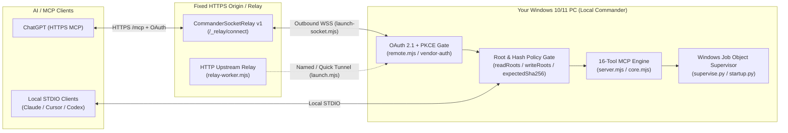

<p>
  
</p>

Bring your Windows workspace into ChatGPT with a self-hosted MCP server for files and process tools.

[](https://github.com/shinjaehyun20/local-commander/actions/workflows/ci.yml) · Windows 10 / 11 · Self-hosted · [MIT](LICENSE)

[Why Local Commander](#why-local-commander) · [Start with ChatGPT](#start-with-chatgpt) · [Keep control](#start-small-keep-control) · [Technical details](#for-a-closer-look) · [한국어 안내](#korean-overview)

---

## Why Local Commander?

Connect ChatGPT or local MCP clients to your Windows PC without routing your source code or shell through a third-party SaaS relay.

| Capability | Commercial Cloud Relay SaaS | Standard Local `stdio` MCP | **Local Commander** |
| :--- | :--- | :--- | :--- |
| **ChatGPT Web / App (Remote HTTPS MCP)** | Paid cloud subscription | Requires manual tunnel + custom auth | **Built-in OAuth 2.1 + PKCE & fixed HTTPS/WSS relay support** |
| **Data Sovereignty & Relay Ownership** | Third-party vendor servers | Local process only | **100% self-hosted on your Windows PC & your own domain/Worker** |
| **Read vs. Write Folder Separation** | Single workspace toggle | Global allowed directories | **Explicit `readRoots` vs. `writeRoots` + symlink/junction escape guard** |
| **Blind-Overwrite Prevention** | Direct overwrite | Direct overwrite | **Mandatory `expectedSha256` optimistic concurrency check on edits** |
| **Orphan / Zombie Process Protection** | Host-dependent | Manual termination | **Windows Job Object (`supervise.py`) cleans up full process trees** |
| **Source Provenance Audit** | Closed or untracked | Untracked | **60 automated tests (49 Node + 11 Python) + `SOURCE_MANIFEST.json` SHA-256 verification** |

---

## Start with ChatGPT

**ChatGPT is in active use with the maintainer's current Windows deployment.**

<details open>
<summary><strong>ChatGPT</strong> · In active use · Connection overview & first prompts</summary>

### Connect ChatGPT to your Windows workspace

ChatGPT uses a fixed HTTPS MCP endpoint. Your Windows PC connects outward through an authenticated relay and handles the file and process tools locally.

### For your own installation

Prepare a Windows server, a compatible fixed HTTPS relay, and authentication and pairing for your ChatGPT connection. The current deployment uses a **CommanderSocketRelay v1** service with an outbound WebSocket connection from the PC.

This repository includes the WebSocket **client** (`relay-socket-client.mjs` / `launch-socket.mjs`) for that existing relay. The included `relay-worker.mjs` implements a separate HTTP upstream relay; it does not provide the WebSocket relay service. The setup wizard creates local configuration, but does not deploy a relay or complete ChatGPT authentication.

See [Architecture and connection requirements](#architecture-and-connection-requirements) for the components and connection paths.

### 3 copy-paste prompts to try first

Once your connection is available, test your setup in increasing order of capability:

**1. Verify workspace boundaries (read-only)**
```text
Use Local Commander to call get_config and list_directory on my configured workspace, then show which folders are readable versus writable.
```

**2. Search and make a SHA-256 guarded edit**
```text
Use Local Commander to search for TODO comments in my workspace with start_search, read the matching file with read_file, and update that exact block using edit_block with its current expectedSha256.
```

**3. Run a supervised verification command**
```text
Use Local Commander to run "npm test" in my project folder with start_process, inspect the output with read_process_output, and summarize the test results.
```

</details>

<details>
<summary><strong>Other MCP clients</strong> · Configuration examples · Connection untested</summary>

The wizard provides templates for **Claude Desktop, Cursor, and Codex CLI**. Connections and tool execution in these apps have not been verified. These examples use the local STDIO server.

### Prepare a new local installation

Requirements: Windows 10 or 11, Git, Node.js 20 or later, and Python 3.11 or later for process supervision and optional login recovery.

```powershell
git clone https://github.com/shinjaehyun20/local-commander.git
cd local-commander
npm ci --ignore-scripts
npm run setup -- --print-clients
```

Choose a folder to read. For a first connection, leave write access and shell execution disabled, and choose `local` deployment mode. The wizard writes `config.json` and prints the client snippets in your terminal.

The snippets contain the absolute paths for your checkout. Use those generated paths in the examples below, and keep any existing servers in your client configuration. Review an existing `config.json` before re-running the wizard: it writes a new configuration and does not preserve every previous option.

### Claude Desktop · Connection untested

Merge the generated `local-commander` entry into the `mcpServers` object in `%APPDATA%\Claude\claude_desktop_config.json`, then quit and reopen Claude Desktop.

```json
{
  "mcpServers": {
    "local-commander": {
      "command": "node",
      "args": ["C:/path/to/local-commander/server.mjs", "--config", "C:/path/to/local-commander/config.json"]
    }
  }
}
```

[Local MCP server configuration guide](https://modelcontextprotocol.io/docs/develop/connect-local-servers)

### Cursor · Connection untested

Merge the entry into `~/.cursor/mcp.json` for your user, or `.cursor/mcp.json` inside the project. The example below adds an explicit `stdio` type to the wizard's command and arguments.

```json
{
  "mcpServers": {
    "local-commander": {
      "type": "stdio",
      "command": "node",
      "args": ["C:/path/to/local-commander/server.mjs", "--config", "C:/path/to/local-commander/config.json"]
    }
  }
}
```

[Cursor MCP configuration guide](https://cursor.com/docs/mcp#configuration-locations)

### Codex CLI · Connection untested

Add the generated TOML section to the active Codex configuration, normally `~/.codex/config.toml`.

```toml
[mcp_servers.local-commander]
command = "node"
args = ["C:/path/to/local-commander/server.mjs", "--config", "C:/path/to/local-commander/config.json"]
```

[Codex MCP configuration guide](https://developers.openai.com/codex/mcp)

### Check the connection in your chosen app

After the app loads the server, use the read request above and inspect the actual tool response. A generated configuration or a visible server entry alone does not verify a successful tool call.

</details>

## Start small. Keep control.

Read first. Add editing or process execution when your workflow needs it.

| Choose the folders | Make deliberate edits | Run on your Windows PC |
| :--- | :--- | :--- |
| File tools use the folders configured for reading and writing. | Existing-file writes check the expected file hash before changing the file. | Your Windows server handles tools locally. An authenticated relay connects it to ChatGPT. |

```json
{
  "name": "Local Commander",
  "readRoots": ["D:\\workspace", "C:\\Docs\\Reference"],
  "writeRoots": ["D:\\workspace\\sandbox"],
  "allowShell": false,
  "allowRemoteWrites": false
}
```

In this configuration, the assistant can inspect files across `D:\workspace` and `C:\Docs\Reference`, can only create or modify files inside `D:\workspace\sandbox` (with `expectedSha256` verification on existing files), and cannot spawn shell processes until `allowShell` is explicitly enabled.

## For a closer look

Inspect the implementation, setup options, and current verification results.

<a id="architecture-and-connection-requirements"></a>

<details>
<summary><strong>Architecture and connection requirements</strong></summary>

### System architecture



### Connection paths

| Path | Entry point | Requirements and behavior |
| :--- | :--- | :--- |
| Local STDIO | `node server.mjs --config config.json` | A local client starts the Node process. File access follows the configured roots; `allowShell` controls process creation. |
| Local read-only HTTP | `node server.mjs --config config.json --http` | Binds to `127.0.0.1` on port `48780` by default. Requires a `tokenFile` containing a bearer token of at least 32 characters. The MCP endpoint exposes read tools and validates a supplied browser Origin. |
| Remote OAuth server | `remote.mjs` | Binds to loopback, serves the OAuth flow and authenticated `/mcp`, and checks `desktop.read`, `desktop.write`, or `process.execute` for tool calls. A separate transport must make the endpoint reachable. |
| Fixed WebSocket relay | `launch.mjs --socket` → `launch-socket.mjs` | Connects outward to an existing compatible CommanderSocketRelay v1 service at `/_relay/connect`. Requires a fixed HTTPS origin, matching relay secret, and deployment-specific authentication and pairing. |
| HTTP upstream relay / named tunnel | `launch.mjs`, `relay-worker.mjs`, `tunnel-config.mjs` | A separate transport path using `cloudflared`. The included Worker accepts upstream registration at `/_relay/register`; it is not the WebSocket relay service. |

The socket launcher restores the remote server and relay connection without creating a first-time pairing code. The standalone remote entry point and the non-socket launcher create pairing codes. Provisioning a new remote deployment therefore requires a pairing path as well as the relay configuration; the desktop-client snippets do not configure ChatGPT.

Source: [server](server.mjs), [remote authentication](remote.mjs), [socket launcher](launch-socket.mjs), [WebSocket client](relay-socket-client.mjs), [HTTP relay Worker](relay-worker.mjs), [tunnel configuration](tunnel-config.mjs).

### File and process boundaries

- File paths are resolved and checked against `readRoots` and `writeRoots`, including resolved symlink or junction targets.
- `write_file` requires the current `expectedSha256` when a file already exists. `edit_block` requires the hash and exactly one matching text block. These are stale-content checks, not exclusive file locks.
- Process execution runs with the Windows user's permissions. The file-tool roots are **not an operating-system sandbox** for launched programs. The current configuration has an `allowShell` switch, not an executable allowlist.
- Windows process supervision uses `supervise.py` and a Job Object for owned process cleanup. Session tools operate on Commander-owned sessions.
- Remote file changes require `allowRemoteWrites`, the relevant OAuth scope, and an allowed write root. Remote process creation requires `allowRemoteWrites`, `allowShell`, `process.execute`, and a working directory within a readable root.
- Authentication state uses atomic JSON writes. Corrupt state is preserved as a backup and raises an error instead of being silently reset.

Source: [file and process core](core.mjs), [process supervision](supervise.py), [remote scope checks](remote.mjs), [state persistence](vendor-auth/config/paths.js). See [SECURITY.md](SECURITY.md) for security reporting.

</details>

<details>
<summary><strong>Setup options and generated configuration</strong></summary>

### A first local read configuration

For a new checkout, the non-interactive equivalent of the read-first setup is:

```powershell
node setup-wizard.mjs --non-interactive --read-root "C:\Projects" --mode local --print-clients
```

Repeat `--read-root` for additional folders. Add a `--write-root` only when you intend to permit file changes in that folder.

| Option | Purpose |
| :--- | :--- |
| `--config <path>` | Choose the output configuration file. Defaults to `config.json` next to the wizard. |
| `--read-root <folder>` | Add a readable folder. Repeat for multiple folders. |
| `--write-root <folder>` | Add a writable folder within a readable root. The default list is empty. |
| `--allow-shell` | Enable process creation. Disabled by default. |
| `--allow-remote-writes` | Allow the remote catalog to expose file mutation and process tools. Disabled by default; OAuth scopes and core policy still apply. |
| `--python <executable>` | Select the Python executable for supervision. |
| `--mode local\|quick\|relay` | Select local configuration, a quick tunnel, or fixed WebSocket relay configuration. Relay mode also needs `--public-url <https-origin>`. |
| `--write-startup-config` | Generate optional `startup-config.json` for login recovery configuration. |
| `--print-clients` | Print the Claude Desktop / Cursor JSON and Codex CLI TOML examples. Interactive setup also prints them. |

The wizard writes `config.json`, creates missing selected root folders, canonicalizes paths with `fs.realpathSync.native`, and derives a workspace identity for a new configuration. In relay mode it also creates or reuses a relay secret. It does not start the server, install a login task, provision the external relay, or register a client connection.

### Generated files and runtime state

| File or location | When it is used |
| :--- | :--- |
| `config.json` | Written by the setup wizard. Review it before connecting a client. |
| `startup-config.json` | Written only when optional startup configuration is selected. |
| Terminal output | Contains desktop-client snippets. The wizard does not save a `client-snippets.json` file. |
| `%LOCALAPPDATA%\local-commander` | Default Windows runtime state directory; `LOCAL_COMMANDER_STATE` can override it. |
| `auth/<workspaceId>.json` | Persisted OAuth registration and token records. |
| `runtime.json` | Service identity and connection state recorded by launchers. |
| `pairing.json` | One-time pairing information written by pairing-capable entry points. |
| `relay.secret` | Local shared-secret file created or reused by relay setup. |

Source: [setup wizard](setup-wizard.mjs), [state paths](vendor-auth/config/paths.js), [startup recovery](startup.py), [startup task installer](install-startup.ps1).

</details>

<details>
<summary><strong>Tools, tests, and current CI</strong></summary>

### Tool catalog

The full server catalog defines 16 tools. The read-only HTTP transport and the remote server with `allowRemoteWrites: false` expose the 10 read and diagnostic tools. A client controls which server tools it makes available in a conversation; the server catalog alone does not verify client exposure.

| Group | Tools | Purpose |
| :--- | :--- | :--- |
| Configuration and diagnostics | `get_config`, `get_usage_stats`, `get_recent_tool_calls` | Inspect policy and catalog information, counters, and bounded recent events. |
| File reading and search | `list_directory`, `read_file`, `read_multiple_files`, `get_file_info`, `start_search` | List, read, inspect, and search within readable roots. Text reads return content hashes; `get_file_info` returns path, size, type, and modification time. |
| Session inspection | `read_process_output`, `list_sessions` | Inspect output and lifecycle state for Commander-owned sessions. |
| File changes | `write_file`, `edit_block`, `create_directory` | Write text, replace an exact block, or create a folder within writable roots. |
| Process control | `start_process`, `interact_with_process`, `force_terminate` | Start a program, send input, or terminate an owned session. |

See the [tool definitions](server.mjs) and [implementation](core.mjs) for exact inputs, limits, and policy checks.

### Verification

[View current main CI results](https://github.com/shinjaehyun20/local-commander/actions/workflows/ci.yml?query=branch%3Amain) · [Browse test source](tests) · [Workflow](.github/workflows/ci.yml)

The repository includes 49 Node.js tests and 11 Python tests covering file and process behavior, tool contracts, OAuth 2.1 + PKCE, atomic state persistence, relay transports, setup wizard canonical path handling, source-manifest integrity, and Windows startup recovery.

On Windows (Node.js 20+ and Python 3.11+):

```powershell
npm test
py -3.11 tests/startup_test.py
```

[SOURCE_MANIFEST.json](SOURCE_MANIFEST.json) records source and test hashes, checked automatically by [the manifest test](tests/manifest.test.mjs). App-level connections, a newly provisioned external relay, and physical Windows reboot or login cycles require their own host verification.

</details>

<a id="korean-overview"></a>

<details>
<summary><strong>🇰🇷 한국어 핵심 가이드 (Korean Overview)</strong></summary>

### Local Commander 요약

**Local Commander**는 Windows 10/11 PC의 로컬 폴더와 프로세스 도구를 **ChatGPT**(고정 HTTPS/WSS 릴레이 및 OAuth 2.1 + PKCE 연동) 또는 로컬 MCP 클라이언트(STDIO)에 연결하는 **100% 셀프호스팅 Windows MCP 서버**입니다.

- **외부 SaaS 중계 서버 무의존**: 서드파티 유료 클라우드 릴레이에 소스 코드나 셸 권한을 맡기지 않고, 본인 소유의 Windows PC와 직접 제어하는 릴레이/도메인에서 동작합니다.
- **읽기/쓰기 경로 분리 및 해시 검증**: `readRoots`와 `writeRoots`를 분리 설정하며, 심볼릭 링크·정션 우회를 차단하고 기존 파일 수정 시 `expectedSha256` 해시 일치를 먼저 확인합니다.
- **Windows Job Object 기반 프로세스 감독**: `supervise.py`를 통해 실행된 프로세스와 하위 자식 트리까지 추적·정리합니다.
- **검증 명령어**:
  ```powershell
  npm ci --ignore-scripts
  npm run setup -- --print-clients
  npm test
  py -3.11 tests/startup_test.py
  ```

</details>

---

[Source code](https://github.com/shinjaehyun20/local-commander) · [MIT License](LICENSE) · [Third-party notices](THIRD_PARTY_NOTICES.md)

Local Commander · A self-hosted Windows MCP server.
